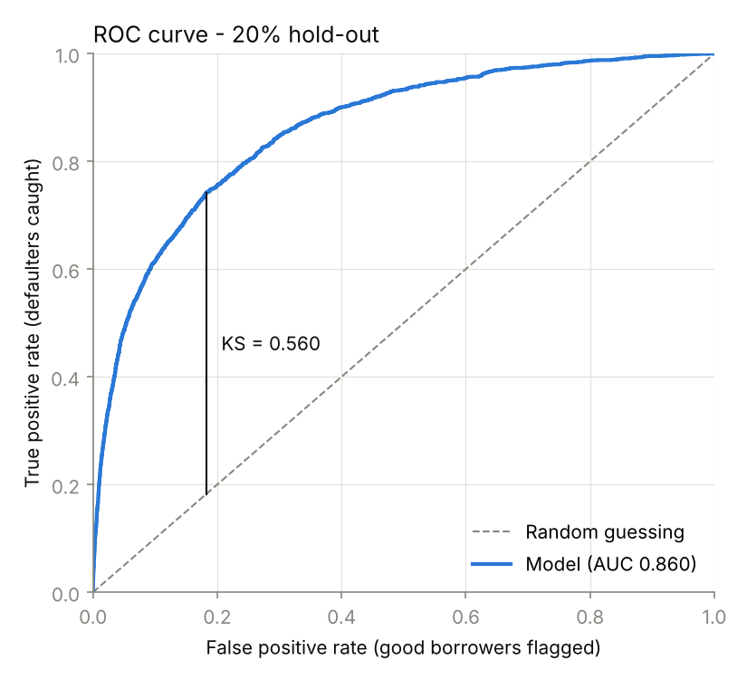

# Credit Risk Scorecard

Banks must predict which borrowers will default, and they must explain every decision, to regulators and to customers they decline.

**What I set out to do.** Build a default-prediction model the way a bank would: accurate, but fully explainable.

**What I did**
- Built a logistic regression scorecard on 150,000 real borrowers, with one clear weight per factor
- Fixed data problems that would quietly mislead the model, such as late-payment counts recorded as 96 or 98 (those borrowers default at 54.6%, about 8× average)
- Converted predictions into a 300–850 credit score, expected-loss estimates and reason codes for declined applicants
- Removed a feature whose effect couldn't be honestly explained to an applicant

**Results**
- **AUC 0.861** on 30,000 unseen borrowers
- **Credit utilization is the biggest risk driver**, roughly doubling the odds of default per standard deviation, far ahead of income
- **The lowest score band holds 12% of borrowers but 62% of expected loss**
- Honest weakness: it overstates risk for the safest borrowers by 2–2.5×

**How it connects.** This is the baseline for my [lending strategy](https://github.com/pooja003-cloud/credit-lending-strategy) project, which challenges it with XGBoost, and my [validation](https://github.com/pooja003-cloud/credit-model-validation) project, which reviews both.

**Run it.** Download `cs-training.csv` from [Kaggle's Give Me Some Credit](https://www.kaggle.com/c/GiveMeSomeCredit/data), save it as `data/credit_data.csv`, then run `pip install -r requirements.txt` and `python scorecard.py`.

**Full details:** methods, all tables and limitations are in [REPORT.md](REPORT.md).
