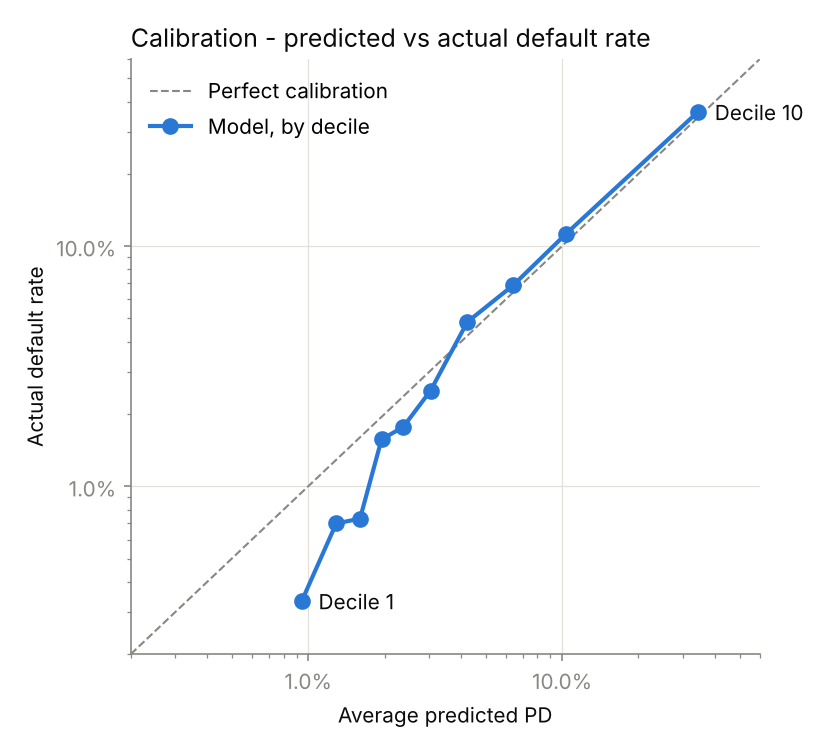

# Credit Risk Scorecard — Interpretable Logistic Regression

A traditional bank-style credit scorecard that predicts the probability of serious delinquency (90+ days past due within two years), converts it to a 300–850 credit score with adverse action reason codes, and estimates the portfolio's expected credit loss. The model is built for **transparency**: every feature's effect on risk is visible, ranked and explainable, the way regulated lenders need it to be.

## Why logistic regression?

Banks must be able to explain their credit decisions — to model validators under model-risk guidance (such as the Fed's SR 11-7), and to customers through adverse action notices (ECOA / Regulation B). A logistic regression gives one clear, signed weight per feature, so you can say exactly what drives a borrower's risk up or down. That makes it the standard baseline for retail credit scoring.

## Results (20% stratified hold-out, 30,000 borrowers)

| Metric | Value | What it means |
|---|---|---|
| AUC | **0.860** | 86% chance a random defaulter is scored riskier than a random non-defaulter |
| Gini | **0.721** | 2 × AUC − 1, the standard industry ranking measure |
| KS | **0.560** | Maximum separation between good and bad borrowers |

<p align="center">
  
  
</p>

### Calibration: are the predicted PDs right?

Ranking borrowers well is not enough for loss estimates; the predicted probabilities also need to match reality. The hold-out set is split into ten equal groups from safest to riskiest:

| Decile | Predicted PD | Actual default rate | Predicted ÷ actual |
|---|---|---|---|
| 1 (safest) | 0.94% | 0.33% | 2.83 |
| 2 | 1.29% | 0.70% | 1.84 |
| 3 | 1.60% | 0.73% | 2.18 |
| 4 | 1.94% | 1.57% | 1.24 |
| 5 | 2.37% | 1.77% | 1.34 |
| 6 | 3.03% | 2.50% | 1.21 |
| 7 | 4.24% | 4.83% | 0.88 |
| 8 | 6.41% | 6.87% | 0.93 |
| 9 | 10.38% | 11.27% | 0.92 |
| 10 (riskiest) | 34.33% | 36.27% | 0.95 |

**What this shows:** the model is well calibrated for the riskier half of the portfolio (within about 5–12%, slightly understating risk), but it **overstates risk for the safest borrowers by roughly two to three times**. A straight-line model cannot bend enough to capture how very-low-risk borrowers behave. This is conservative (it errs toward caution, not optimism), and it matters little in dollar terms because the safest deciles carry little expected loss. The fixes are WoE binning or a recalibration step (see *Limitations*).

### Risk Weight Matrix

Standardized coefficients, so features are directly comparable. *Odds ×* is how much default odds multiply for a one-standard-deviation increase.

| Rank | Feature | Coef | Odds × | Effect |
|---|---|---|---|---|
| 1 | Revolving utilization of unsecured lines | +0.689 | 1.99 | Raises risk |
| 2 | Times 90+ days late | +0.333 | 1.39 | Raises risk |
| 3 | Times 30–59 days past due | +0.308 | 1.36 | Raises risk |
| 4 | Age | −0.248 | 0.78 | Lowers risk |
| 5 | Times 60–89 days past due | +0.202 | 1.22 | Raises risk |
| 6 | Open credit lines and loans | +0.186 | 1.20 | Raises risk |
| 7 | Monthly income | −0.154 | 0.86 | Lowers risk |
| 8 | Debt ratio | −0.135 | 0.87 | Lowers risk* |
| 9 | Real estate loans or lines | +0.129 | 1.14 | Raises risk |
| 10 | Past-due history recorded as special code (flag) | +0.100 | 1.10 | Raises risk |
| 11 | Income not reported (flag) | +0.087 | 1.09 | Raises risk |
| 12 | Number of dependents | +0.047 | 1.05 | Raises risk |

**Key takeaway:** credit card utilization and past delinquency history dominate default risk. Utilization alone roughly doubles the odds of default per standard deviation, while monthly income has a much smaller effect.

\*See *Limitations* for why debt ratio shows a counter-intuitive sign.

### Credit score bands

Scores use the industry "points to double the odds" method: 650 points = 20:1 good-to-bad odds, and every 50 points doubles the odds.

| Score band | Borrowers | Share | Predicted PD | Actual default rate |
|---|---|---|---|---|
| Poor (300–579) | 3,721 | 12.4% | 30.11% | 32.20% |
| Fair (580–669) | 7,876 | 26.3% | 6.68% | 7.19% |
| Good (670–739) | 12,532 | 41.8% | 2.27% | 1.70% |
| Very Good (740–799) | 5,805 | 19.4% | 1.12% | 0.48% |
| Exceptional (800–850) | 66 | 0.2% | 0.55% | 0.00% |

Default rates fall steadily as scores rise, from about 32% in the lowest band to under 1% in the top bands. The gap between predicted and actual in the top bands is the same overstatement seen in the calibration table.

### Expected loss

Banks measure credit losses with **Expected Loss = PD × LGD × EAD**: the probability of default, the share of the exposure lost if default happens, and the amount owed at default. This model supplies the PD. The dataset has no balances or recovery data, so LGD and EAD use illustrative, industry-typical assumptions for unsecured credit cards:

- **Credit limit:** $10,000 per borrower (assumed)
- **EAD** = drawn balance + 50% of the unused limit (a 50% credit conversion factor, since borrowers tend to draw down their lines before defaulting)
- **LGD:** 80% (unsecured cards typically lose 75–85% after default)

| Score band | Exposure ($) | Expected loss ($) | Avg EL per borrower ($) | Loss rate |
|---|---|---|---|---|
| Poor (300–579) | 34,506,295 | 8,420,199 | 2,263 | 24.40% |
| Fair (580–669) | 62,455,649 | 3,457,903 | 439 | 5.54% |
| Good (670–739) | 70,918,757 | 1,309,279 | 104 | 1.85% |
| Very Good (740–799) | 30,085,875 | 268,964 | 46 | 0.89% |
| Exceptional (800–850) | 338,596 | 1,482 | 22 | 0.44% |
| **Portfolio** | **198,305,174** | **13,457,827** | **449** | **6.79%** |

**Key takeaway:** the Poor band holds 12% of borrowers but 63% of expected loss. That is the kind of concentration a bank acts on through approval cut-offs, credit limits and pricing.

The loss figures cover the same two-year horizon as the default target. They show how a PD model plugs into loss estimation; the dollar amounts depend on the assumptions above.

### Scoring a new applicant, with reason codes

`score_applicant()` takes an applicant's raw details and returns their score, PD and the top three factors pushing their risk above the average borrower. These are the reasons a lender would list on an adverse action notice if the applicant were declined. For a logistic model, each feature's contribution is simply its weight × the applicant's standardized value.

```python
from scorecard import score_applicant

score_applicant({
    "RevolvingUtilizationOfUnsecuredLines": 0.95, "age": 28,
    "NumberOfTime30-59DaysPastDueNotWorse": 3, "DebtRatio": 0.40,
    "MonthlyIncome": 6000, "NumberOfOpenCreditLinesAndLoans": 8,
    "NumberOfTimes90DaysLate": 0, "NumberRealEstateLoansOrLines": 0,
    "NumberOfTime60-89DaysPastDueNotWorse": 0, "NumberOfDependents": 0,
})
```

| Applicant | Profile | Score | PD | Top reasons |
|---|---|---|---|---|
| Maria | 28, uses 95% of her credit, 3 payments 30–59 days late, earns $6,000/month | **472** (Poor) | 37.3% | Payments 30–59 days late · High revolving utilization · Younger age |
| James | 52, uses 10% of his credit, never late, earns $4,500/month | **717** (Good) | 1.9% | — approved |

Maria earns more than James, but her utilization and late payments make her about 20 times riskier.

## Method

1. **Clean** — the 96/98 values in the past-due counts are data-entry codes, not real counts. Those borrowers default at 54.6% (about 8× average), so a flag keeps that signal before the codes are set to missing. A second flag marks the 19.8% of borrowers with no reported income.
2. **Split first** — stratified 80/20 train/test split *before* any fitting, so nothing from the test set leaks into training.
3. **Cap outliers** — clip each feature at the training set's 1st and 99th percentiles.
4. **Impute + scale + model** — median imputation, standardization and logistic regression, all in one scikit-learn `Pipeline` fitted on training data only.
5. **Validate** — AUC, Gini and KS on the hold-out set (accuracy is misleading when only ~7% of borrowers default), plus a 10-decile calibration check.
6. **Explain** — rank standardized coefficients into the Risk Weight Matrix.
7. **Score** — convert probability of default to a 300–850 score and check default rates by band.
8. **Estimate losses** — combine PD with assumed LGD and EAD to calculate expected loss by score band and for the whole portfolio.
9. **Reason codes** — score individual applicants and list the factors driving their risk.

## Project structure

```
credit-risk-scorecard/
├── scorecard.py            # training pipeline + score_applicant()
├── requirements.txt        # pinned versions (the saved model needs the same scikit-learn)
├── data/                   # place credit_data.csv here (not tracked)
└── outputs/
    ├── roc_curve.png
    ├── calibration.png
    ├── risk_weight_matrix.csv
    ├── scorecard_model.pkl  # pipeline + outlier caps + score and loss settings
    └── run_output.txt       # full console output of the latest run
```

## How to run

1. Download `cs-training.csv` from the [Give Me Some Credit competition](https://www.kaggle.com/c/GiveMeSomeCredit/data) (free Kaggle account required).
2. Save it as `data/credit_data.csv`.
3. Install and run (Python 3.11 or newer):

```bash
python3 -m venv .venv && source .venv/bin/activate
pip install -r requirements.txt
python scorecard.py
```

The dataset is not included in this repository, in line with Kaggle's competition rules.

## Limitations and next steps

- **Calibration for the safest borrowers.** The model overstates PD by about 2–3× in the safest three deciles. WoE binning (below) or an isotonic / Platt recalibration step on held-out data would correct it.
- **Debt ratio sign.** On its own, a higher debt ratio does go with more defaults (about 5% in the lowest decile vs 11% in the highest). Once utilization, open credit lines and real-estate loans are in the model, debt ratio adds little, and its remaining weight is slightly negative. Blanking it when income is missing and log-transforming it were both tested: neither changed the sign or the AUC. It is excluded from reason codes, because "debt ratio too low" is not a valid reason to decline someone.
- **Linear effects only.** Features enter the model as straight lines. A production scorecard would use Weight of Evidence (WoE) binning with monotonic constraints and a points-per-attribute table, which captures non-linear patterns while staying interpretable.
- **Real LGD and EAD models.** With account-level balance, limit and recovery data, LGD and EAD would be modelled per borrower instead of assumed.
- **Monitoring.** Population Stability Index (PSI) tracking would detect when incoming applicants drift from the training population.

## Data

[Give Me Some Credit](https://www.kaggle.com/c/GiveMeSomeCredit) (Kaggle, 2011): 150,000 borrowers, 10 numeric features, target `SeriousDlqin2yrs`.
